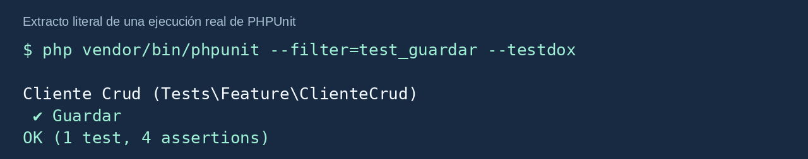
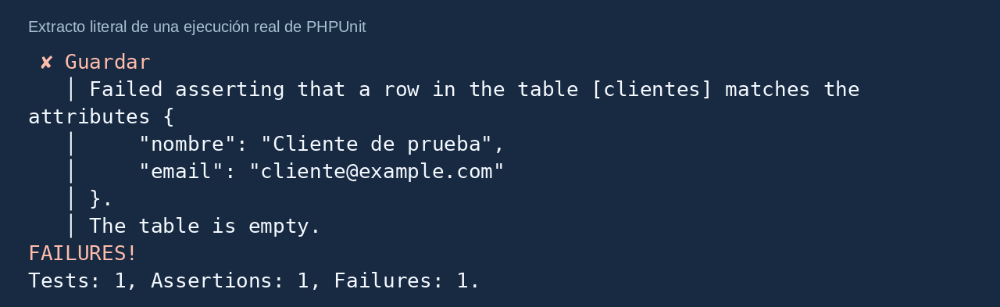
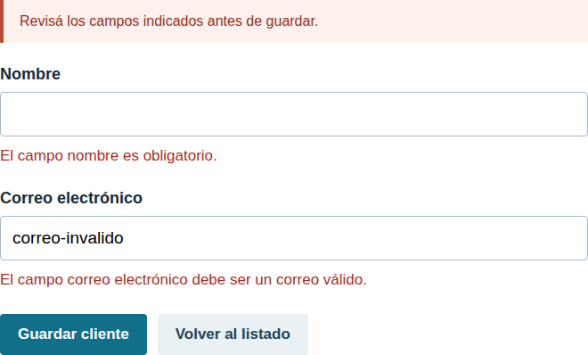
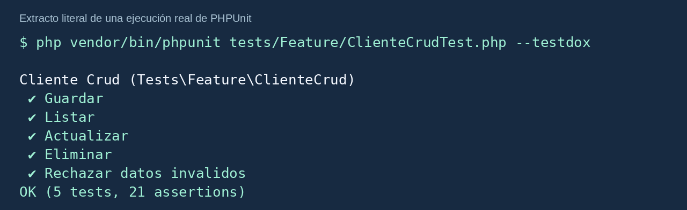

# Mi primera prueba con PHPUnit

Una guía visual para entender las pruebas y llevarlas a un CRUD en Laravel 12.

Primero imaginamos una tarea muy sencilla. Después escribimos una prueba de una suma. Por último comprobamos las operaciones de un CRUD de clientes.


**La idea central:** decidir qué debería ocurrir, ejecutar el código y comprobar qué ocurrió.

Podés leer esta guía por tu cuenta o usarla junto con la presentación. El proyecto descargable contiene todos los archivos de los ejemplos, con comentarios.

<!-- page -->

# 1. La historia del robot inspector

Imaginá que un pequeño robot recibe una tarea: **sumar 2 y 3**. Antes de tocar la calculadora, ya sabemos qué resultado debe obtener: **5**.


El robot ejecuta la tarea y mira el resultado. Si obtuvo 5, la comprobación pasa. Si obtuvo 6, hay una diferencia que debemos revisar.

| Parte del caso | En este ejemplo |
|---|---|
| Entrada | Los números 2 y 3. |
| Acción | Ejecutar la suma. |
| Resultado esperado | El número 5. |
| Resultado real | El valor que devolvió el programa. |

**Fundamento:** una comprobación necesita un criterio de corrección. Ese criterio viene de la regla que debe cumplir el programa. Lo definimos antes de ejecutar.

<!-- page -->

# 2. Esperado, real y fallo

**Esperado** significa lo que debería ocurrir según la regla. **Real** significa lo que ocurrió al ejecutar.


| Esperado | Real | Resultado de la comprobación |
|---|---|---|
| 5 | 5 | Pasa. |
| 5 | 6 | Falla. |

Una prueba fallida señala que una condición no se cumplió. Revisamos la implementación, la preparación y la expectativa para entender la diferencia.

En el fallo que provocamos en esta clase, conocemos la suma correcta y modificamos el cálculo para que devuelva 6. El código entregado está corregido.

**Fundamento:** el resultado del propio programa no alcanza para decidir que está bien. Necesitamos compararlo con una expectativa definida por la regla.

<!-- page -->

# 3. Qué son una prueba, PHPUnit y un assert

Una **prueba automática** es código que prepara una situación, ejecuta una acción y comprueba el resultado. Podemos repetirla al cambiar el programa.

**PHPUnit** encuentra y ejecuta nuestros casos escritos en PHP. Nosotros elegimos las entradas y definimos lo que debería pasar.

Un **assert**, o aserción, expresa una condición que esperamos que sea verdadera. Si la condición no se cumple, PHPUnit marca el caso como fallido.

```php
$this->assertSame(5, $resultado);
```

Esta línea pide que el resultado real coincida con el entero 5. El esperado va primero; el real, después. `assertSame` compara valor y tipo.

**Por qué importa el tipo:** el entero `5` y el texto `'5'` tienen tipos distintos. `assertSame` detecta esa diferencia.

**Fundamento:** el assert debe expresar una condición relacionada con el resultado que buscamos. La línea por sí sola no guarda, arregla ni modifica el programa.

`$this` representa la instancia de nuestra clase de prueba. Esa clase tiene los métodos de aserción que heredó de su clase base.

<!-- page -->

# 4. Los tres pasos del caso

| Paso | Para qué sirve | Ejemplo de la suma |
|---|---|---|
| Preparar | Definir la situación necesaria. | Crear una calculadora. |
| Ejecutar | Invocar lo que queremos probar. | Pedir `sumar(2, 3)`. |
| Comprobar | Contrastar con la expectativa. | Esperar el entero 5. |

También podés encontrar los nombres **Arrange, Act y Assert**. Son estos mismos pasos.

```php
$calculadora = new Calculadora();
$resultado = $calculadora->sumar(2, 3);
$this->assertSame(5, $resultado);
```

La primera línea crea el objeto. La segunda ejecuta nuestro método y conserva el valor que devuelve. La tercera revisa ese valor.

**Fundamento:** separar los pasos ayuda a distinguir qué datos elegimos, qué comportamiento estamos ejecutando y qué resultado nos importa.

Para cada caso prepararemos su propia situación. Así podemos ejecutarlo solo o junto con los demás.

<!-- page -->

# 5. Preparar el proyecto de la clase

Necesitás PHP 8.2 o superior, Composer y las extensiones habituales de Laravel y PHPUnit. Para los casos del CRUD necesitás `pdo_sqlite` en el PHP de la terminal.

Descomprimí el ZIP y entrá en la carpeta `laravel-crud`, donde está `artisan`. El proyecto ya contiene la calculadora, el CRUD y sus pruebas.

```bash
composer install
```

Copiá `.env.example` como `.env` desde el explorador de archivos. En Linux/macOS podés usar:

```bash
cp .env.example .env
```

En PowerShell:

```powershell
Copy-Item .env.example .env
```

Después ejecutá:

```bash
php artisan key:generate
php artisan config:clear
```

**Fundamento:** Composer instala las dependencias, incluyendo PHPUnit. `APP_KEY` prepara la aplicación y `config:clear` evita usar una configuración anterior guardada en caché.

No necesitás iniciar `php artisan serve` para estas pruebas. La calculadora se ejecuta directamente y las solicitudes del CRUD se simulan dentro de Laravel.

<!-- page -->

# 6. El código que queremos comprobar

Archivo completo: `app/Services/Calculadora.php`.

```php
<?php

namespace App\Services;

class Calculadora
{
    public function sumar(int $a, int $b): int
    {
        return $a + $b;
    }
}
```

| Elemento | Qué significa |
|---|---|
| `class Calculadora` | Define la clase de nuestro objeto. |
| `public function sumar` | Declara un método que podemos llamar. |
| `int $a, int $b` | Recibe dos números enteros. |
| `: int` | Devuelve un número entero. |
| `return $a + $b` | Entrega la suma al código que lo llamó. |

**Fundamento:** probamos un comportamiento de nuestro código. En este ejemplo, la clase puede calcular sin usar base de datos ni servicios de Laravel.

<!-- page -->

# 7. El archivo de la primera prueba

Este archivo muestra un único caso para empezar. El ZIP ya agrega otros dos dentro de la misma clase.

Archivo: `tests/Unit/CalculadoraTest.php`.

```php
<?php

namespace Tests\Unit;

use App\Services\Calculadora;
use PHPUnit\Framework\TestCase;

class CalculadoraTest extends TestCase
{
    public function test_suma_positivos(): void
    {
        $calculadora = new Calculadora();
        $resultado = $calculadora->sumar(2, 3);
        $this->assertSame(5, $resultado);
    }
}
```

`use` importa los nombres de las clases. `extends TestCase` permite utilizar las aserciones de PHPUnit.

El prefijo `test_` identifica el método como un caso. `public` permite ejecutarlo y `void` indica que no devuelve un valor.

**Fundamento:** el archivo de prueba organiza los casos que comprobarán nuestra clase. Esta prueba es **unitaria aislada**: no inicia Laravel ni usa su base de datos.

<!-- page -->

# 8. Leer el resultado de la ejecución

Desde la carpeta del proyecto:

```bash
php vendor/bin/phpunit --filter=test_suma_positivos --testdox
```

`--filter` selecciona el método. `--testdox` presenta los nombres de forma legible.

La ejecución registrada dio:

```text
Suma positivos
OK (1 test, 1 assertion)
```

**Qué significa:** se ejecutó un caso y se cumplió su comprobación. El resultado real coincidió con el entero 5.

**Fundamento:** que este caso pase demuestra que se cumple esta expectativa para las entradas 2 y 3. Para comprobar otras situaciones elegimos otros casos.

Los logs íntegros acompañan el proyecto en `material_clase/salidas`.

<!-- page -->

# 9. Un fallo explicado

En la calculadora cambiamos temporalmente:

```php
return $a + $b;
```

por:

```php
return $a + $b + 1;
```


Con entradas 2 y 3, la implementación devuelve 6. El esperado sigue siendo 5. PHPUnit informó:

```text
Failed asserting that 6 is identical to 5.
```

**Cómo lo resolvemos:** restauramos el cálculo correcto y volvemos a ejecutar. El código entregado está restaurado y los casos pasan.

**Fundamento:** leemos qué diferencia encontró el assert. En esta demostración conocemos la expectativa correcta y corregimos la implementación.

<!-- page -->

# 10. Más casos de la calculadora

| Caso | Entrada | Esperado |
|---|---|---|
| Positivos | 2 y 3 | 5 |
| Número negativo | -2 y 3 | 1 |
| Con cero | 0 y 7 | 7 |

El ZIP tiene un método `test_` por fila. Cada uno crea su propia calculadora, ejecuta la suma y compara con su esperado.

Para ejecutar los tres:

```bash
php vendor/bin/phpunit tests/Unit/CalculadoraTest.php --testdox
```

Ejecución registrada: **3 tests, 3 assertions correctos**.

**Por qué escribimos 5, 1 o 7:** son resultados conocidos para las entradas elegidas. Si diseñamos otro caso, debemos definir su esperado correcto.

Evitá usar como esperado el resultado que acaba de devolver el mismo método que querés probar. Compararlo consigo mismo no permitiría detectar el error.

**Fundamento:** una expectativa útil ofrece un criterio de corrección independiente del resultado que observamos.

<!-- page -->

# 11. La misma idea aplicada al CRUD

CRUD significa crear, leer, actualizar y eliminar datos. Nuestro módulo administra clientes con `nombre` y `email`.

| Operación | Lo que esperamos |
|---|---|
| Guardar | Un registro nuevo con los datos enviados. |
| Listar | Una página que muestre el cliente preparado. |
| Actualizar | El mismo ID con los valores nuevos. |
| Eliminar | Que ese ID deje de existir. |
| Rechazar datos inválidos | Errores de validación y ninguna inserción. |

En la calculadora revisamos un número. En el CRUD revisamos **la respuesta de Laravel** y **los efectos sobre la base**.

Una redirección puede ocurrir aunque el programador haya olvidado guardar. Por eso también buscamos los datos en la base.

**Fundamento:** las comprobaciones derivan del comportamiento esperado de la operación. Cada situación del plan de pruebas puede convertirse en un caso automático.

<!-- page -->

# 12. Los registros que prepara cada caso


La base del ejemplo usa SQLite en memoria. Las tablas se preparan con las migraciones y `RefreshDatabase` mantiene independientes los datos de los casos.

| Caso | Situación inicial |
|---|---|
| Guardar | Sin clientes. La operación debe crear uno. |
| Listar | Un cliente creado por la propia prueba. |
| Actualizar | Un cliente creado por la propia prueba. |
| Eliminar | Un cliente creado por la propia prueba. |
| Entrada inválida | Sin clientes. La operación debe rechazarla. |

**Fundamento:** preparar exactamente la situación necesaria evita depender de registros del navegador o de lo que hizo otro test. Cada caso se puede ejecutar solo.

`RefreshDatabase` usa la conexión configurada; la selección de SQLite en memoria está en `phpunit.xml`.

<!-- page -->

# 13. Los datos del caso y sus valores

```php
$datos = [
    'nombre' => 'Cliente de prueba',
    'email' => 'cliente@example.com',
];
```


`nombre` y `email` son los campos que espera este módulo. Los textos de la derecha son valores ficticios elegidos para el caso. `$datos` conserva el array.

Podés elegir otro nombre y otro correo que cumplan las reglas de este CRUD. Después enviamos `$datos` y comprobamos que se haya guardado su contenido.

**Fundamento:** en este CRUD simple la regla de persistencia es guardar los datos válidos que recibió. Por eso la expectativa puede reutilizar la entrada. Si otro sistema transforma o normaliza datos, definí lo esperado según esa regla.

Esta comprobación estudia una combinación elegida. Otras condiciones, límites o errores necesitan otros casos.

<!-- page -->

# 14. La clase del CRUD

Los métodos del CRUD van dentro de esta clase. En el ZIP ya está completa.

Archivo: `tests/Feature/ClienteCrudTest.php`.

```php
<?php

namespace Tests\Feature;

use App\Models\Cliente;
use Illuminate\Foundation\Testing\RefreshDatabase;
use Tests\TestCase;

class ClienteCrudTest extends TestCase
{
    use RefreshDatabase;

    // Acá agregamos los métodos test_ del CRUD.
}
```

Aquí `TestCase` es la clase de Laravel, ubicada en `Tests`. Permite enviar solicitudes a la aplicación y examinar sus respuestas. `Cliente` es el modelo del módulo.

`use RefreshDatabase` dentro de la clase incorpora el comportamiento para preparar y aislar sus datos.

Para generar un archivo PHPUnit en otro proyecto:

```bash
php artisan make:test ClienteCrudTest --phpunit
```

**Fundamento:** estos casos hacen trabajar juntas varias partes de la aplicación. En Laravel son **Feature** y ejercitan integración entre rutas, controlador, validación, modelo y base.

<!-- page -->

# 15. Guardar: el caso completo

Este método va dentro de `ClienteCrudTest`.

```php
public function test_guardar(): void
{
    // 1. Preparar. Podés cambiar estos valores por otros válidos.
    $datos = [
        'nombre' => 'Cliente de prueba',
        'email' => 'cliente@example.com',
    ];

    // 2. Ejecutar. Enviamos los datos al CRUD.
    $respuesta = $this->post('/clientes', $datos);

    // 3. Comprobar. Deben guardarse los mismos datos que enviamos.
    $this->assertDatabaseHas('clientes', $datos);
    $respuesta->assertRedirect('/clientes');
    $this->assertDatabaseCount('clientes', 1);
}
```

**Por qué cada línea importa:**

- `$datos` define una entrada válida del caso.
- `post` envía esa entrada a la ruta de guardar y devuelve `$respuesta`.
- `assertDatabaseHas` busca los mismos valores enviados.
- `assertRedirect` comprueba que la respuesta lleve al listado.
- `assertDatabaseCount` comprueba que se haya creado exactamente una fila.

**Fundamento:** verificamos el contenido, la cantidad y la respuesta producidos por la misma solicitud. La prueba empieza sin clientes.

<!-- page -->

# 16. Guardar: adaptar y ejecutar

Elegí otros valores válidos en `$datos`:

```php
$datos = [
    'nombre' => 'Otro ejemplo válido',
    'email' => 'otro.ejemplo@example.com',
];
```

La comprobación conserva la regla:

```php
$this->assertDatabaseHas('clientes', $datos);
```

Para ejecutar solo guardar:

```bash
php vendor/bin/phpunit --filter=test_guardar --testdox
```



**Fundamento:** la aserción no repite un nombre y correo literales. Busca el contenido que eligió este caso. Las rutas y campos sí deben corresponder al módulo que estás probando.

El número de assertions puede superar las líneas visibles porque algunos helpers hacen más de una comprobación interna.

<!-- page -->

# 17. Guardar: comprender el fallo

En esta demostración se quitó temporalmente `Cliente::create($datos);` de `store`. El controlador seguía redirigiendo, pero no insertaba el registro.



`assertDatabaseHas` esperaba encontrar los atributos enviados. El mensaje informa que la tabla está vacía.

**Cómo reproducirlo en la copia de práctica:** comentá esa instrucción, ejecutá `test_guardar`, leé la diferencia, restaurá la instrucción y ejecutá de nuevo.

**Fundamento:** una respuesta HTTP correcta por sí sola no demuestra que se guardaron los datos. El código del proyecto entregado está restaurado.

<!-- page -->

# 18. Listar: preparar y comprobar el contenido

Este caso prepara su propio `$datos`; no comparte variables con guardar.

```php
public function test_listar(): void
{
    $datos = [
        'nombre' => 'Cliente de prueba',
        'email' => 'cliente@example.com',
    ];
    Cliente::create($datos);

    $respuesta = $this->get('/clientes');

    $respuesta->assertOk();
    // Usamos el nombre que preparó ESTA prueba.
    $respuesta->assertSee($datos['nombre']);
}
```

`Cliente::create` prepara un registro para el listado. `get` pide la página. `assertOk` espera HTTP 200 y `assertSee` busca el nombre elegido por el caso.

**Fundamento:** abrir una página no acredita que muestre el dato necesario. Por eso también comprobamos el contenido. En esta prueba examinamos la respuesta de Laravel.

<!-- page -->

# 19. Actualizar: el mismo ID con valores nuevos

El caso crea un cliente y conserva su modelo en `$cliente`. Después elige datos diferentes para modificarlo.

```php
public function test_actualizar(): void
{
    $datos = [
        'nombre' => 'Cliente de prueba',
        'email' => 'cliente@example.com',
    ];
    $cliente = Cliente::create($datos);
    $nuevosDatos = [
        'nombre' => 'Cliente actualizado',
        'email' => 'actualizado@example.com',
    ];

    $respuesta = $this->put('/clientes/' . $cliente->id, $nuevosDatos);

    $respuesta->assertRedirect('/clientes');
    // El mismo ID debe contener ambos valores nuevos.
    $this->assertDatabaseHas('clientes', [
        'id' => $cliente->id,
        'nombre' => $nuevosDatos['nombre'],
        'email' => $nuevosDatos['email'],
    ]);
    // Esperado primero; real después. fresh() vuelve a leer la base.
    $this->assertSame($nuevosDatos['nombre'], $cliente->fresh()->nombre);
    $this->assertDatabaseCount('clientes', 1);
}
```

**Fundamento:** la modificación debe afectar al registro elegido, conservar su ID y guardar ambos valores nuevos. `fresh()` vuelve a leer el registro; así `assertSame` observa el valor actual de la base. La cantidad sigue en 1.

<!-- page -->

# 20. Eliminar: comprobar la ausencia

La prueba crea el registro que después solicita eliminar.

```php
public function test_eliminar(): void
{
    $datos = [
        'nombre' => 'Cliente de prueba',
        'email' => 'cliente@example.com',
    ];
    $cliente = Cliente::create($datos);

    $respuesta = $this->delete('/clientes/' . $cliente->id);

    $this->assertDatabaseMissing('clientes', ['id' => $cliente->id]);
    $respuesta->assertRedirect('/clientes');
    $this->assertDatabaseCount('clientes', 0);
}
```

`$cliente->id` contiene el ID generado por este caso. `assertDatabaseMissing` verifica que ya no exista una fila con ese ID.

**Fundamento:** usamos el registro preparado por el test para ejecutar y comprobar la operación. La cantidad 0 corresponde a este caso, que había creado un único cliente. Si tu sistema usa borrado lógico, adaptá lo esperado a esa regla.

<!-- page -->

# 21. Rechazar datos inválidos

Enviamos un nombre vacío y un email con formato inválido. Esperamos errores y ninguna inserción.

```php
public function test_rechazar_datos_invalidos(): void
{
    $datosInvalidos = ['nombre' => '', 'email' => 'correo-invalido'];

    $respuesta = $this->from('/clientes/create')
        ->post('/clientes', $datosInvalidos);

    $respuesta->assertSessionHasErrors(['nombre', 'email']);
    $this->assertDatabaseCount('clientes', 0);
    $respuesta->assertRedirect('/clientes/create');
}
```

`from` prepara la URL de regreso. `assertSessionHasErrors` busca errores en los campos indicados. `assertDatabaseCount` comprueba que la tabla siga vacía. `assertRedirect` comprueba volver al formulario.

**Fundamento:** el rechazo es el resultado correcto de este caso. Una prueba negativa pasa cuando el sistema responde como esperábamos ante esa entrada. Puede haber muchos casos negativos.



<!-- page -->

# 22. Los asserts de esta clase

| Aserción | Pregunta que responde |
|---|---|
| `assertSame(esperado, real)` | ¿Coinciden en valor y tipo? |
| `assertDatabaseHas(tabla, datos)` | ¿Existe una fila con estos atributos? |
| `assertDatabaseCount(tabla, cantidad)` | ¿La tabla tiene esa cantidad exacta? |
| `assertDatabaseMissing(tabla, atributos)` | ¿Ya no existe una fila con esos atributos? |
| `assertOk()` | ¿La respuesta tiene estado HTTP 200? |
| `assertSee(texto)` | ¿El contenido de la respuesta incluye ese texto? |
| `assertRedirect(url)` | ¿La respuesta redirige a esa URL? |
| `assertSessionHasErrors(campos)` | ¿Hay errores asociados a esos campos? |

Los asserts de respuesta se llaman sobre `$respuesta`. Los de base se llaman sobre `$this`, la instancia de la prueba.

**Cómo elegir:** escribí primero la expectativa en palabras. Después elegí el assert que permite comprobarla. Cada comprobación debe aportar información sobre el comportamiento elegido.

En un formulario web suele haber redirección al guardar o al rechazar datos. En una API JSON se pueden esperar otros estados y contenidos; adaptá el caso a la respuesta definida por tu sistema.

<!-- page -->

# 23. Ejecutar los casos y distinguir su alcance

Solo los cinco casos del CRUD:

```bash
php vendor/bin/phpunit tests/Feature/ClienteCrudTest.php --testdox
```



Ejecución registrada: **5 tests, 21 assertions correctos**.

La suite completa incluye las tres sumas y cuatro extensiones opcionales de pantallas y recurso inexistente:

```bash
php vendor/bin/phpunit --testdox
```

Ejecución registrada: **12 tests, 33 assertions correctos**.

**Alcance:** la calculadora es unitaria aislada. El CRUD es Feature y comprueba integración. PHPUnit ejecuta ambos. Cada método es independiente; un caso prepara lo que necesita sin esperar que otro lo haga antes.

<!-- page -->

# 24. Configuración y dudas frecuentes

En `phpunit.xml`, dentro de `<php>`, el proyecto ya tiene:

```xml
<env name="APP_ENV" value="testing" force="true"/>
<env name="DB_CONNECTION" value="sqlite" force="true"/>
<env name="DB_DATABASE" value=":memory:" force="true"/>
<env name="DB_URL" value="" force="true"/>
```

`force` impone esos valores para esta ejecución. `:memory:` selecciona una base SQLite en memoria. Limpiá configuración con `php artisan config:clear`.

**Si pide login:** prepará un usuario permitido antes de la solicitud. Importá `App\Models\User` y usá:

```php
$usuario = User::factory()->create();
$this->actingAs($usuario);
```

Si el proyecto exige roles o permisos, asigná los que requiera el caso. Autenticar un usuario no determina por sí solo sus permisos.

**Si dice could not find driver:** revisá `php -m` y habilitá `pdo_sqlite` en el PHP de la terminal.

**Si un ID no existe:** las rutas con model binding pueden responder 404. Usá el ID del registro que creaste cuando el caso requiere uno existente.

**Si aparece otro valor en la base:** revisá qué enviaste, las reglas del sistema y el assert que falló.

**Fundamento:** distinguimos un error de preparación de una diferencia entre el comportamiento esperado y el observado.

<!-- page -->

# 25. Actividades con respuestas explicadas

**Actividad 1: otra suma.** Escribí un caso para 3 y 4. Definí el esperado antes de llamar al método.

Respuesta:

```php
$calculadora = new Calculadora();
$resultado = $calculadora->sumar(3, 4);
$this->assertSame(7, $resultado);
```

**Por qué:** 7 es el resultado conocido de esa entrada.

**Actividad 2: otros valores de guardar.** Elegí un nombre y correo válidos propios. Conservá `assertDatabaseHas('clientes', $datos)`.

**Por qué:** la regla de persistencia pide guardar el contenido enviado. Esa variable sirve como entrada y como atributos esperados.

**Actividad 3: solo el email es inválido.** Prepará un nombre válido y email inválido. Enviá POST y comprobá error en `email` y cantidad 0.

```php
$datos = ['nombre' => 'Cliente de prueba', 'email' => 'invalido'];
$respuesta = $this->post('/clientes', $datos);
$respuesta->assertSessionHasErrors(['email']);
$this->assertDatabaseCount('clientes', 0);
```

**Por qué:** la entrada debe ser rechazada por el formato del email y no producir una inserción. Es otro caso negativo con su expectativa propia.

<!-- page -->

# 26. Guion para exponer y fundamento documental

**Para empezar:**

“Imaginemos una tarea sencilla: sumar 2 y 3. Antes de ejecutarla sabemos que debería dar 5. Después miramos qué devolvió. Una prueba automática escribe esa comparación en código. PHPUnit la ejecuta y los asserts indican qué debe cumplirse.”

**Para conectar con el CRUD:**

“La idea es la misma, pero ahora el resultado incluye una respuesta y cambios en la base. Si enviamos datos válidos para guardar, esperamos encontrar esos mismos datos. Para actualizar o eliminar, la prueba prepara su propio cliente y utiliza su ID.”

**Para cerrar:**

“Primero explicamos la expectativa en palabras. Después preparamos la situación, ejecutamos la operación y comprobamos lo ocurrido. El tipo de prueba depende de las partes que participan.”

Recorrido de la presentación: conceptos y calculadora en las diapositivas 1–15; CRUD en 16–37; alcance, adaptación y práctica en 38–42; consulta y fuentes en 43–45.

Los ejemplos y la historia son propios. La semántica de las aserciones, los helpers y el entorno de pruebas se apoyan en documentación oficial:

- Laravel 12: https://laravel.com/docs/12.x/testing
- Solicitudes y respuestas: https://laravel.com/docs/12.x/http-tests
- Comprobaciones de base: https://laravel.com/docs/12.x/database-testing
- PHPUnit 11.5: https://docs.phpunit.de/en/11.5/assertions.html

Los resultados completos están en `material_clase/salidas`. Las imágenes de PHPUnit amplían extractos literales de ejecuciones reales. Las ilustraciones del robot ayudan a explicar conceptos mediante una historia.
